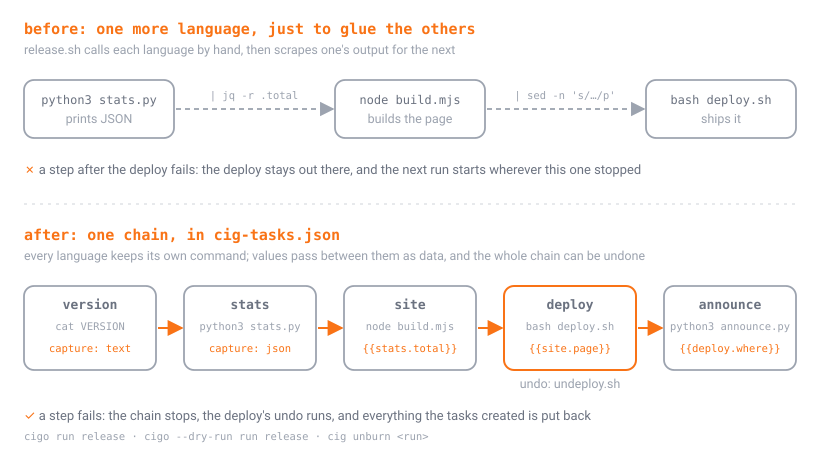
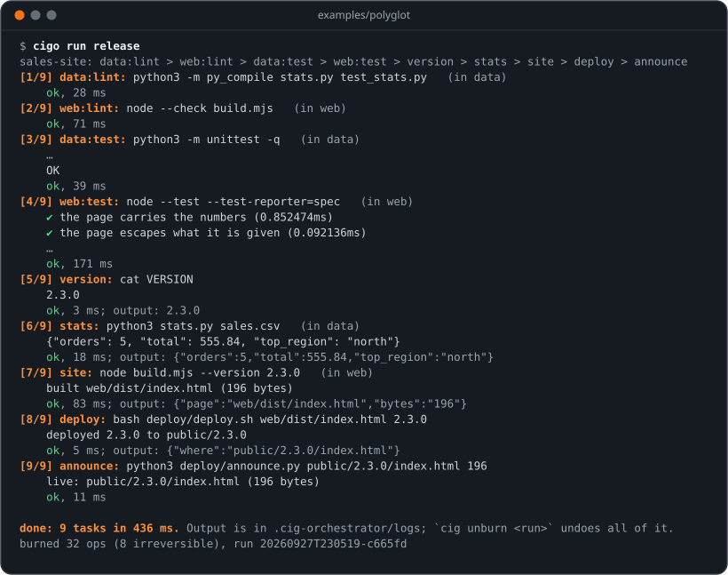
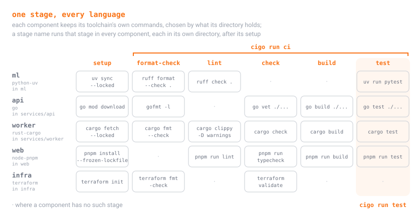

<p align="center">
  
</p>

<p align="center">
  <b>Every language in the project, one chain, no glue script.</b><br>
  <i>A tool from the maker of <a href="https://github.com/otmof-ops/cig-script">CigScript</a>, so you can start using it without starting over.</i>
</p>

<p align="center">
  <a href="https://github.com/otmof-ops/cig-script"></a>
  
  <a href="TOOLCHAINS.md"></a>
  <a href="docs/roadmap.md"></a>
  <a href="LICENSE"></a>
  
</p>

Most projects are several languages in a row. A Python step makes the data,
a Go service and a Rust worker build on it, a TypeScript front end renders
it, and a bash script ships it. Each language brings its own tool (`uv`,
`go`, `cargo`, `pnpm`), and the chain between them ends up in one more
language: a `Makefile` or a `release.sh` whose only job is to call the
others in order, scrape one tool's output with `jq` for the next, and hope
nothing fails halfway.

**`cigo` is that glue, done once.** It knows the standard workflow of 60
toolchains, finds every language in your project, runs one stage across all
of them in dependency order, and hands values from one language to the next
as data. Your tools and scripts stay exactly as they are, and none of them
needs to know CigScript exists. The chain gets everything CigScript gives a
script: a dry run you can trust, rollback you never wrote, and an undo for
next week.

<p align="center"></p>

## Thirty seconds

```sh
cd your-project
cigo adopt                 # every language, task runner and script folder it finds
cigo adopt --write         # saved as cig-tasks.json; edit anything, it is yours
cigo check                 # loops, typos, missing tools and broken templates, before anything runs
cigo --dry-run run ci      # the whole plan, nothing executed
cigo run ci                # format-check, lint, check, build and test, in every language
cig unburn <run>           # changed your mind: everything back
```

[Getting started](docs/getting-started.md) walks through it on a real
project in five minutes, install included.

## See it run

[`examples/polyglot`](examples/polyglot) is four languages in one chain,
with Python 3, Node 18 and `cigcompile` to install. Python totals a CSV,
Node builds a page from those numbers, bash deploys it with an undo, and
Python reports where it went; a CigarScript component is checked, tested and
built into a program on the way, and a failed deploy takes the program back.
Before any of that, each language's own lint and tests run:

<p align="center"></p>

Nothing in that chain parses another program's output by hand. `stats`
captures Python's JSON, `site` reads `{{stats.total}}` from it, `build.mjs`
hands on the page's path by writing `page=...` to `$CIG_OUTPUT`, and bash
receives it as an argument. If `announce` had failed, the deploy's undo
would have run and the chain would have put back what it created.

## What you get

| what you get | how |
|---|---|
| one command per stage, every language | `cigo run test` runs `uv run pytest`, `go test`, `cargo test` and `pnpm run test`, each in its own directory |
| values across languages | Python's JSON becomes Node's environment and bash's arguments as `{{stats.total}}`, with no parsing in between |
| your scripts, as they are | `adopt` turns `scripts/`, Makefile targets, `package.json` scripts, justfile recipes and Taskfile tasks into tasks without touching them |
| a dry run | `cigo --dry-run run release` plans every task and executes none |
| rollback | the files your tasks create are journaled; when a later task fails, the run puts them back, newest first |
| an undo for next week | `cig unburn <run>` undoes a whole run that succeeded |
| an undo for what cig cannot see | a task's `undo` (a deploy's teardown, say) runs on rollback and on `cig unburn` |
| nothing done twice | a task with `inputs` is skipped while its files, and the values it was handed, are unchanged |
| checked first | `cigo check` finds loops, typos, unknown toolchains, missing programs and broken templates before anything runs |
| the tools themselves | `ciginstaller doctor --tools` (`cigo doctor` runs it) shows each toolchain's tools and versions against the pins you already keep; every command warns where a version disagrees, the installed cig against the project's pins included, and `--strict` stops on one. `cigo versions switch` runs tasks on the pinned versions through the version manager already on the machine (mise, asdf, rustup, uv, fnm...), per task, never your default |
| what a task rewrites | on Linux every task runs in cig's box, over a copy-on-write layer on the project: a task that cannot start leaves nothing, and every change one that ran made comes back on rollback, named or not. Elsewhere a format stage's sources and a setup stage's lockfiles are kept in the tin before the task runs; `touches` names a task's own, `touches_sealed` what to keep encrypted |
| every package manager, guarded | `cigo guard scope dev` puts `npm install`, `npx`, `pip install`, `cargo build` and the rest behind the same guard as a task, in any folder: your blacklist, OSV and the static read, then on Linux a rehearsal in cig's contained box, with `cigo undo last` after. `npm test` and the other calls that run nothing new pass straight through. `curl ... | sh` typed at the prompt is cancelled, and `cigo run-url` rehearses the script first. At level 4 every shell command your AI agent runs is read, boxed and undoable (`cigo agent undo`), and the risky ones wait for you (`cigo approve`) |
| cigo itself | its own bugs reported through cig's ashtray under cig's one consent setting, never a task's failure; `cigo report [<run>]` and `cigo crash` (list, show, send, delete) hand over to ciginstaller (`ciginstaller bug cigo`, `ciginstaller crash`); installed, updated and removed by ciginstaller (`cigo update` and `cigo uninstall` hand over to it), `cigo version --json` |

## One stage, every language

<p align="center"></p>

The commands are the ones each ecosystem documents: lockfile-respecting
installs (`--locked`, `--frozen-lockfile`, `npm ci`), the package manager the
lockfile or `packageManager` field names, the project's own `package.json`
scripts where it has them, and the formatter and linter it configures (Ruff
or Black, Biome or Prettier and ESLint, golangci-lint when it has a config).
[TOOLCHAINS.md](TOOLCHAINS.md) lists all 61: JavaScript and TypeScript,
Python, Rust, Go, the JVM, .NET, C and C++, Ruby, PHP, Elixir, Swift, Dart,
Zig, Haskell, CigarScript and more, plus Terraform, Docker, Helm and the task runners you
already have. Anything a project does differently is one line in its
manifest; [your own toolchains](docs/custom-toolchains.md) shows how.

## Guides

| guide | read it when you want to |
|---|---|
| [Getting started](docs/getting-started.md) | install cig and cigo, and run your first stage across a project |
| [Adopting a project](docs/adopting-a-project.md) | bring an existing repository over without rewriting anything |
| [Chaining languages](docs/chaining-languages.md) | pass values from one language to the next, with recipes for bash, Python, Node, Go, Rust, Ruby and PowerShell |
| [Coming from make, just, npm scripts and friends](docs/coming-from.md) | map what you already know onto cigo, and see what it adds and what it doesn't do |
| [The manifest](docs/manifest.md) | look up any key in `cig-tasks.json` |
| [Commands](docs/commands.md) | look up any command, flag, exit code or file cigo keeps |
| [Your own toolchains](docs/custom-toolchains.md) | change a built-in toolchain for your project, or teach cigo a new one |
| [cigo in CI](docs/ci.md) | run the same chain on GitHub Actions or GitLab CI |
| [Troubleshooting](docs/troubleshooting.md) | understand a message, or a task that won't run |
| [Measuring cigo](docs/benchmarks.md) | time the hook and the guard with `cig bench --watch`, see where a start goes, and read the corpus score |
| [How it works](docs/how-it-works.md) | read the tool's insides before you change them |
| [Roadmap](docs/roadmap.md) | see what's coming, and how a request gets there |

## A note from the maker

I made CigScript because automation should respect your time and your
sanity. The fastest way to show a language is worth your time is to not ask
you to throw away the work you already have. So this tool takes the scripts,
the Makefile, the `package.json` and the toolchains you already use, and runs
them through CigScript exactly as they are.

It exists for two reasons. One is to take real work off your hands today.
The other is to show you that I care about making your work easier, by
making your tools do it the smarter way.

This is a serious project, and it is actively maintained:

- **Problems get fixed.** Report one and you get a fix, and a test that keeps
  it fixed.
- **More adoption tools are coming.** This is the first; the
  [roadmap](docs/roadmap.md) says what's next.
- **Quality-of-life requests are wanted.** If your other language or tool
  does something better, [tell me what it
  is](https://github.com/otmof-ops/cig-orchestrator/issues/new?template=qol-request.yml).
  I watch those requests, and the good ones land.
- **Ask for help, any time.** If you're bringing a project over and you're
  stuck, [open a guidance
  request](https://github.com/otmof-ops/cig-orchestrator/issues/new?template=guidance-request.yml)
  and I'll help you directly.

I want CigScript to be the best option for this work, and that only happens
one way: hardening it, and making it the choice that respects your time and
your sanity.

*Jay*

## Get help, ask for things, pitch in

| you want to | go here |
|---|---|
| get unstuck bringing a project over | [a guidance request](https://github.com/otmof-ops/cig-orchestrator/issues/new?template=guidance-request.yml) |
| have cigo know a language or tool it doesn't | [a toolchain request](https://github.com/otmof-ops/cig-orchestrator/issues/new?template=toolchain-request.yml) |
| get something your other tool does better | [a quality-of-life request](https://github.com/otmof-ops/cig-orchestrator/issues/new?template=qol-request.yml) |
| report something that went wrong | `ciginstaller bug cigo`, or without it [a bug report](https://github.com/otmof-ops/cig-orchestrator/issues/new?template=bug-report.yml) |
| report a problem in the language itself | [CigScript's issues](https://github.com/otmof-ops/cig-script/issues) |
| report a security problem | [SECURITY.md](SECURITY.md), never a public issue |
| send a fix or a toolchain | [CONTRIBUTING.md](CONTRIBUTING.md) |

[SUPPORT.md](SUPPORT.md) says what happens after you ask.

## Install

Needs `cig` 1.20.0 or newer. cigo is installed by
[ciginstaller](https://github.com/otmof-ops/cig-installer), which also
installs and checks the `cig` it runs on. With ciginstaller on the machine:

```sh
ciginstaller install stick cigo
cigo version
```

No ciginstaller yet? Its [install section](https://github.com/otmof-ops/cig-installer#install)
says how to get it today. Once ciginstaller has a release, that is its bootstrap
script: download it, check it, read it, then run it:

```sh
gh release download -R otmof-ops/cig-installer -p install.sh -p install.sh.sha256
sha256sum -c install.sh.sha256
less install.sh        # read it, then run it
sh install.sh
```

The installer updates, checks and removes cigo as well: `ciginstaller update`
(`--check` only looks), `ciginstaller doctor --tools` (it shows cigo's own
findings: the cig floor, the launcher, the guard, what a rehearsal can use,
and each toolchain against the project's pins) and `ciginstaller uninstall
cigo` (it takes the guard's shims and startup-file blocks out first). `cigo
update`, `cigo doctor` and `cigo uninstall` run those for you. The release
tarball, its `.sha256` and its build attestation are what the installer
reads; `gh attestation verify cig-orchestrator-vX.Y.Z.tar.gz -R
otmof-ops/cig-orchestrator` checks one by hand. `install.sh` and
`install.ps1` in the tarball and the repository only say this, for one
release.

To work on cigo, run it from a checkout: `git clone
https://github.com/otmof-ops/cig-orchestrator && cd cig-orchestrator`, then
`bin/cigo run ci` ([CONTRIBUTING.md](CONTRIBUTING.md)). Without the launcher,
the tool is one file: `cig run path/to/orchestrate.cig -- run ci`.

## Where it runs

Linux and macOS, on both architectures; FreeBSD, Alpine and Termux with
`bash` installed; Windows, natively from PowerShell and cmd (`cigo.cmd` and
the `cigo.launch.ps1` it runs) and from Git Bash and WSL. The suite runs in CI on Ubuntu,
macOS, Windows and Alpine. cig itself runs the tasks: a `shell` line runs
under `sh` wherever one exists, Git for Windows included, and under `cmd`
only where it does not; a timeout ends the whole process tree on every
platform. Keep a WSL project in the Linux filesystem: hop watching on
`/mnt/c` is slow, and Windows' `npm` shim on the interop PATH will not run.

## Limits, honestly

- A task's output is shown when the task finishes, not as it runs. Long
  builds are quiet until they are done.
- Tasks run one at a time.
- On Linux, where tasks run in cig's box, everything a task changes inside
  the project comes back on rollback. On macOS and Windows, files a task
  *creates* inside the project are undone, and the files it *modifies* or
  deletes come back when the task said it might touch them (`touches`;
  format and setup stages say so on their own); anything else it modifies is
  listed as irreversible, with the detail. Everywhere, what a task puts in
  `.git`, `node_modules`, `target`, `.venv` and the other build and
  dependency trees stays, and is never journaled.
- The knowledge base holds each ecosystem's documented defaults. A build that
  needs an argument (an Xcode scheme, a Flutter platform, one solution out of
  several) says so in a stage override, and [TOOLCHAINS.md](TOOLCHAINS.md)
  notes which ones.

Each of these is on the [roadmap](docs/roadmap.md), and what building this
turned up in CigScript itself is in [FINDINGS.md](FINDINGS.md).

## Part of CigScript

cigo is written in CigScript, one file (`orchestrate.cig`), and it uses the
language the way you would: each command is a hop, the tasks are a chain
built at run time, the project is the pack, and a task's undo is a
compensation. CigScript itself, the lexicon, and the rules the kernel keeps
are at [otmof-ops/cig-script](https://github.com/otmof-ops/cig-script).

## Licensing

- **Code** (`orchestrate.cig`, `bin/`, `install.sh`, `tests/`): **source-available, not open source.** Under the
  [Functional Source License, version 1.1, with an Apache-2.0 future license
  (FSL-1.1-ALv2)](LICENSE). The Open Source Initiative does not count it as an
  open source license, and this project does not call it one.
  - *What you may do.* Use it, including inside a company for its own work;
    read it, study it, change it and share it with the license attached; and
    help others use it. The source is here for all of that.
  - *What you may not do.* Make it available to others in a commercial product
    or service that substitutes for it or does the same job. Selling it, or
    selling access to it, is the clear case.
  - *It becomes Apache-2.0.* Each version converts to
    [Apache-2.0](LICENSES/Apache-2.0.txt) two years after it is made
    available.
  - *Earlier releases.* Every release through v1.18.0 was made under Apache-2.0 and stays under it. [LICENSING.md](LICENSING.md)
    lists which versions carry which license.
- **Documentation** (`docs/`, this README and the other guides at the root):
  [CC BY 4.0](LICENSES/CC-BY-4.0.txt). Reuse and adapt with credit.
- **Examples** (`examples/`): [CC0 1.0](LICENSES/CC0-1.0.txt). Paste them
  into your own projects; no attribution needed.
- **The name.** cig-orchestrator and cigo are trademarks of Jay Taylor, as
  CigScript is, and cigo carries that name as the maker's own tool. A fork
  needs a name of its own; [TRADEMARKS.md](TRADEMARKS.md) says what is free
  to do and what to ask about first.
- **Your project is yours.** Nothing about running cigo gives this project
  any rights in your manifest, your scripts or what your tools build.

`cig` is installed separately and is not part of this repository; its own
licensing is at [otmof-ops/cig-script](https://github.com/otmof-ops/cig-script#licensing).
[REUSE.toml](REUSE.toml) maps every path to its license. Contributions are
accepted under the same terms; see [CONTRIBUTING.md](CONTRIBUTING.md).
Security reports: [SECURITY.md](SECURITY.md).

Copyright (c) 2026 Jay Taylor (https://github.com/otmof-ops/cig-orchestrator).
