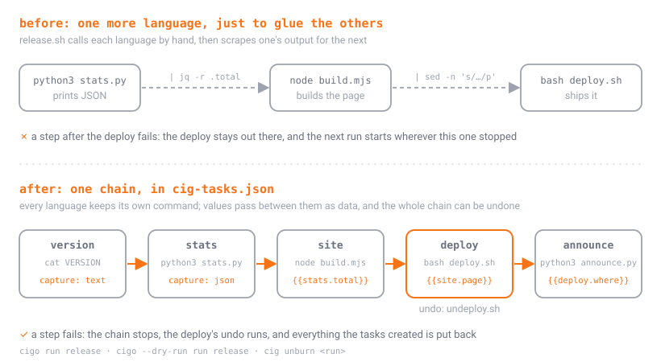

# polyglot

Four languages in one chain, and no glue script at the end of it.

<p align="center"></p>

- **Python** (`data/stats.py`) totals a sales CSV and prints the result as
  JSON.
- **Node** (`web/build.mjs`) builds `web/dist/index.html` from those numbers,
  which reach it as environment variables, and hands on the page's path by
  writing `page=...` to `$CIG_OUTPUT`.
- **bash** (`deploy/deploy.sh`) publishes the page under the release number,
  with `deploy/undeploy.sh` as its undo, and **Python** again
  (`deploy/announce.py`) reports where it went.

- **CigarScript** (`cigar/release-note.cigar`) is a component too, with the
  `cigarscript` toolchain: `cigcompile build --check` lints it, `cigar check`
  checks it, `cigcompile build` makes `cigar/bin/release-note`, and
  `cigar run --dry-run` tests it. `cigar.toml` pins the cigar it is built
  with; the installer picks the cigcompile that pin names.

Each language keeps its own tests (`python3 -m unittest`, `node --test`,
`cigar run --dry-run`) as components, so `cigo run test` runs all three, and
`release` runs every language's lint, check, build and tests, then packages
the CigarScript program (`cigcompile build --sbom`), before the chain.
Nothing to install beyond Python 3, Node 18, and `cigcompile` and `cigar`
(`ciginstaller install carton`).

```
cd examples/polyglot
cigo list
cigo --dry-run run release    # the plan; templates stay {{...}} since nothing ran
cigo run release              # lint, check, build and test every language, then version > stats > site > deploy > announce
cigo outputs stats            # the numbers Python handed on, as JSON
cigo run site                 # up to date: same sources, same numbers
echo "south,500.00" >> data/sales.csv
cigo run site                 # rebuilt: Python's numbers changed, so Node's page did
cig unburn <run>              # the release taken back: the deploy's undo runs, the page and the program go
```

The CigarScript program is built into `cigar/bin/`, which the toolchain
declares under `touches`: a release that fails after the build (a deploy that
errors, a test that breaks) puts it back, the same as the page.

`DEPLOY_TO=/somewhere/else cigo run release` publishes outside the project,
where only the undo can reach it. Break a test (`data/test_stats.py` or
`web/render.test.mjs`) to watch the chain stop before anything is deployed.
